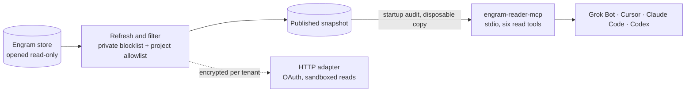

<div align="center">


# engram-reader

**Read privacy-filtered Engram memory through MCP.**

[](LICENSE)
[](#quick-setup)

Works with **Engram** · **MCP**

</div>

---

A generic, read-only MCP server over a privacy-filtered [Engram](https://github.com/Gentleman-Programming/engram) memory snapshot. Use the same stdio command with Grok Bot, Cursor, Claude Code or Codex. A separate Streamable HTTP adapter implements OAuth and tenant isolation for development of remote integrations.

The name describes the read-only interface without tying it to a client or vendor. The six tools are `mem_search`, `mem_context`, `mem_get_observation`, `mem_timeline`, `mem_stats` and `mem_list_projects`. Writes, arbitrary SQL, shell execution and outbound fetch tools are unavailable.



## Quick setup

Validated on macOS with Engram 3.3.2 and Python 3.12. The HTTP adapter's worker isolation requires the macOS sandbox. The installer sets up a generic launch agent for refresh every 15 minutes. Installing the reader alone leaves scheduling to you.

```sh
python3 -m venv .venv
.venv/bin/python -m pip install "pip @ https://files.pythonhosted.org/packages/3f/06/3e4420302363fbb71be3c7f35ce042f54bfca330e3e66b3a2e3c4cca579f/pip-26.2.2-py3-none-any.whl#sha256=fd7f4dfa8190e014013b9f08f3e973f4e4c26ffd179a204895533a7254813a70"
.venv/bin/python -m pip install -r requirements-connector.txt
mkdir -p "$HOME/.config/engram-reader"
cp scripts/blocked-terms.example.json "$HOME/.config/engram-reader/blocked-terms.json"
chmod 600 "$HOME/.config/engram-reader/blocked-terms.json"
```

Edit the private file to add terms you want withheld, then install against your source store:

```sh
PATH="$PWD/.venv/bin:$PATH" scripts/install-engram-reader.sh --source "$HOME/.engram"
```

The blocklist is local private configuration. The repository ships only an empty example, so there are no universal exclusions. Configure it before exposing memory to any client. Matching is case-insensitive and applies Unicode normalization and confusable handling to every string field and field name. Matching rows are dropped; source memory is never rewritten.

Policy lookup uses `ENGRAM_READER_BLOCKLIST` when set; otherwise it uses `$XDG_CONFIG_HOME/engram-reader/blocked-terms.json`, falling back to `~/.config/engram-reader/blocked-terms.json`. A missing default means an empty policy. An explicitly selected missing file, invalid JSON or a symlink fails closed. State lives in `$XDG_DATA_HOME/engram-reader`, falling back to `~/.local/share/engram-reader`. Checkout and state files are never implicit blocklist sources.

Set a pinned allowlist in the state directory's `allowed-projects.json` to restrict projects:

```json
{"mode": "pinned", "projects": ["synthetic-project"]}
```

Refresh after changing the allowlist or blocklist:

```sh
python3 scripts/engram_reader.py refresh
python3 scripts/engram_reader.py verify
```

Automatic mode initially selects all projects that survive filtering. A pinned empty project list publishes no memory. Refresh audits the snapshot and publishes an audit receipt beside it. MCP startup verifies the snapshot and current policy hashes against that receipt, then serves a disposable copy. A missing or stale receipt triggers a full audit before serving. The HTTP export requires an explicitly present blocklist and pinned allowlist, even when either list is empty.

## Plugin package

This repository is a single Cursor-format plugin with one skill and one MCP server. The package uses `.cursor-plugin/plugin.json`, root `mcp.json`, and `skills/engram-reader/SKILL.md`. Component paths are explicit and relative to the plugin root. The discovery keyword and intended listing category are MCP; catalog placement is selected during listing rather than through an undocumented manifest field.

Run the setup above before enabling the plugin on the conversation computer. Its stdio entry launches `engram-reader-mcp`, so `~/.local/bin` must be in the client's PATH. The plugin does not install Engram, refresh snapshots, upload memory or change private policy automatically. The skill permits only the six read tools, prohibits writing memory and prohibits running the plain Engram CLI or bypassing the filtered server.

The package is validated against the [Cursor plugin reference](https://cursor.com/docs/reference/plugins) and the [official template validator](https://github.com/cursor/plugin-template/blob/main/scripts/validate-template.mjs). Tests also start the command declared in `mcp.json` with disposable synthetic state and verify MCP initialization and the six-tool list. Actual Grok Bot plugin installation, displayed Skills and MCP components, and exact dialog fields remain manual acceptance checks.

## Grok Bot

Open **Setup → Plugins → Custom MCP server → Command** and use:

```text
engram-reader-mcp
```

The command is installed in `~/.local/bin`; use its expanded local path if the conversation computer does not inherit that directory in PATH. The exact dialog fields are to be confirmed. The command must be installed on the computer running the conversation. [Official custom server types and plugin setup](https://docs.x.ai/grok-bot/team-bots#plugins).

Grok Bot also documents **Custom MCP server → Remote HTTPS**. A future deployed adapter would use its HTTPS `/mcp` URL and OAuth flow. The included loopback adapter is a synthetic development service, and the exact Bot callback and registration contract remain to be validated.

## Cursor

Add this to `~/.cursor/mcp.json` and restart or enable the server. Ensure `~/.local/bin` is in the client process's PATH, or replace the command with its expanded local path.

```json
{
  "mcpServers": {
    "engram-reader": {"command": "engram-reader-mcp", "args": []}
  }
}
```

[Cursor MCP configuration](https://cursor.com/docs/mcp).

## Claude Code

Add this to the project's `.mcp.json` and approve the project server:

```json
{
  "mcpServers": {
    "engram-reader": {"type": "stdio", "command": "engram-reader-mcp", "args": []}
  }
}
```

Alternatively register the installed launcher directly:

```sh
claude mcp add --scope user --transport stdio engram-reader -- "$HOME/.local/bin/engram-reader-mcp"
```

[Claude Code MCP configuration](https://code.claude.com/docs/en/mcp).

## Codex

Add this to `~/.codex/config.toml`. Ensure the launcher is in PATH, or substitute its expanded local path.

```toml
[mcp_servers.engram_reader]
command = "engram-reader-mcp"
args = []
```

[Codex MCP configuration](https://developers.openai.com/codex/mcp).

## HTTP mode and verification

See [HTTP connector setup](docs/HTTP-CONNECTOR.md) for OAuth, transport configuration and the production deployment gates, and [Privacy and architecture](docs/PRIVACY.md) for data boundaries.

```sh
.venv/bin/python -B -m unittest discover -s tests -v
```

The suite uses synthetic users, projects and exclusion terms in temporary stores. It tests real stdio initialization, all six tools over HTTP, OAuth refresh and revocation, encrypted tenant isolation, sandbox restrictions, atomic publication and private config loading. Client UI acceptance remains a separate manual check.

Run the optional performance regression with 3,000 synthetic exclusion terms and 2,000 synthetic observations:

```sh
ENGRAM_READER_BENCHMARK=1 .venv/bin/python -B -m unittest discover -s tests -p test_fast_start.py -k large_synthetic -v
```

It reports refresh and MCP initialize times and requires initialization within three seconds. It uses temporary synthetic state and never reads or changes installed private policy.

Released under the [MIT license](LICENSE).

Python downloads require patched trust tooling: pip >=26.2.2 (bootstrap above),
certifi >=2026.10.19, and uv >=0.13.4 when using uv.
